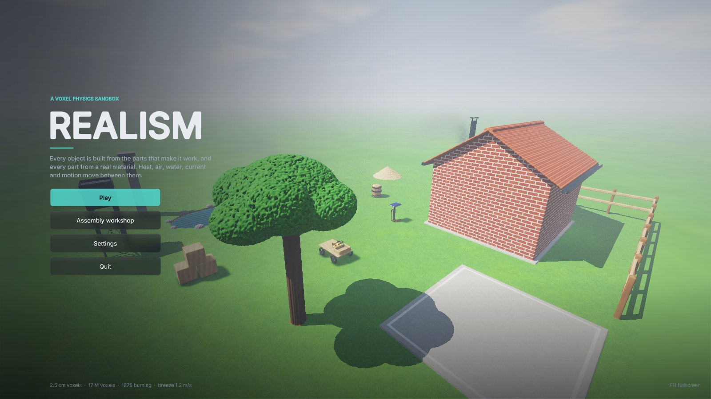
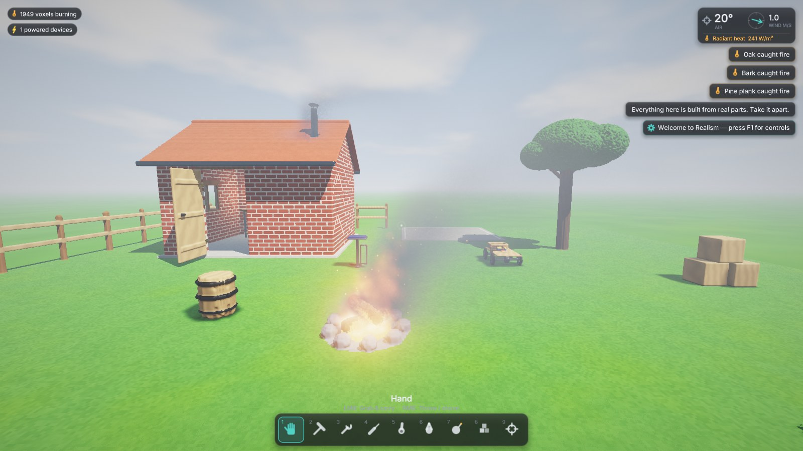
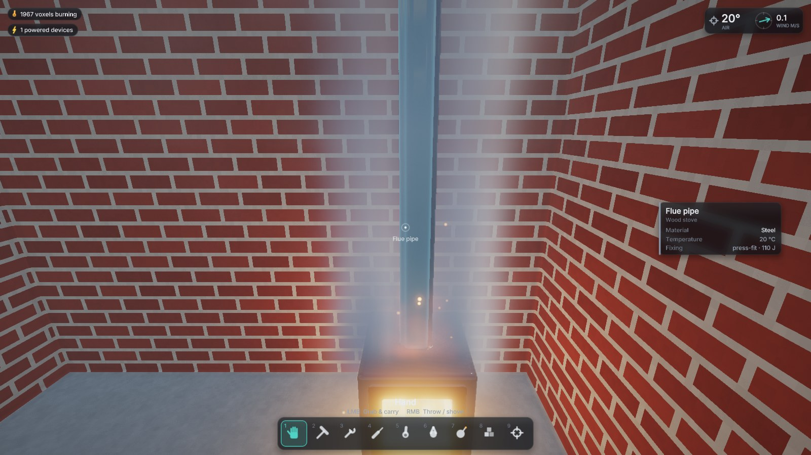
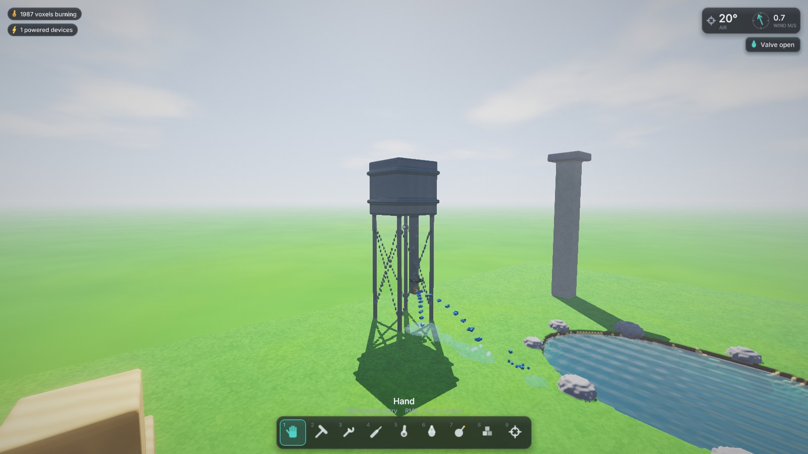
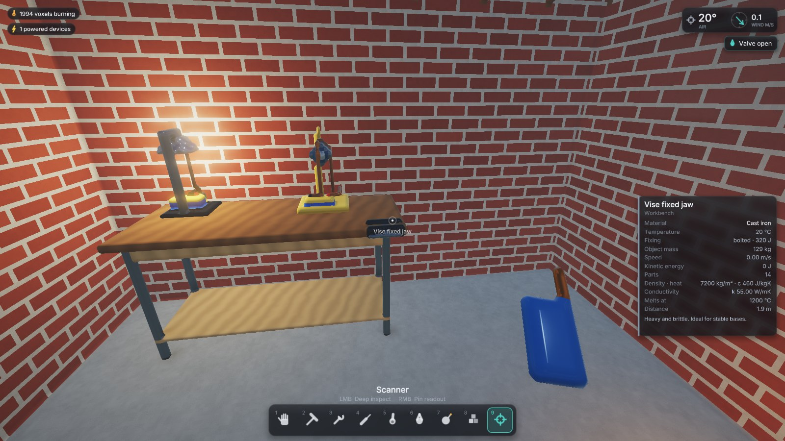
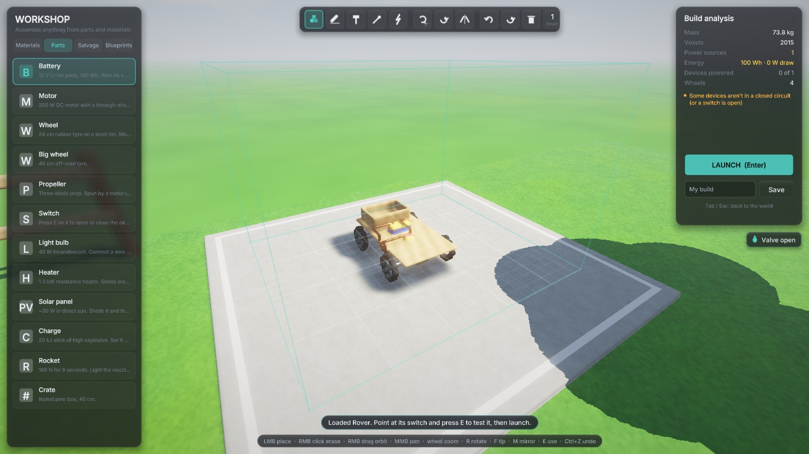
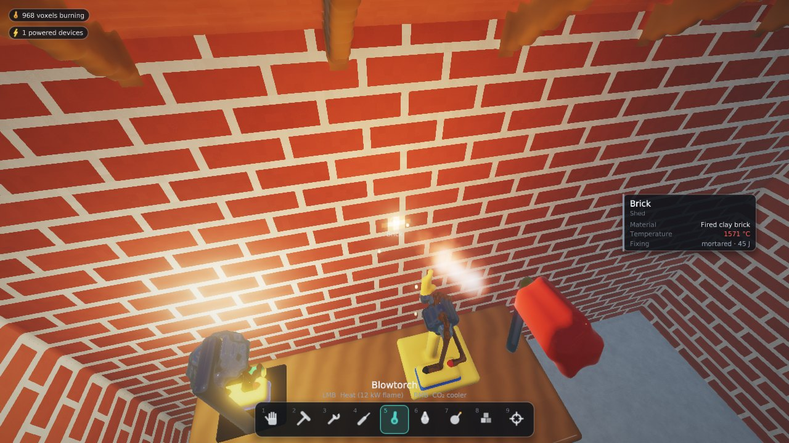
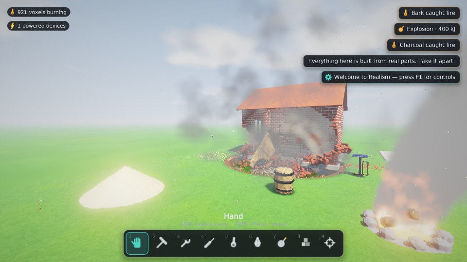

# Realism

A voxel physics sandbox for Windows where every object is assembled from the parts that would make it work, and every part is made of a real material.

The desk lamp is a cast-iron base, a 12 V Li-ion pack with + and − terminals, a toggle switch, copper flex routed up a steel pole, an aluminium shade and a glass bulb with a tungsten filament. The shed is individual bricks laid in mortar under oak rafters and clay tiles, with gutters, a ridge cap and a stone sill. The wood stove in its corner is a steel firebox with a glass door and air slots, logs burning inside, and a flue through the roof that really draws: the hot gas rises up the pipe and the smoke leaves at the chimney. The water tower by the pond is a steel tank on braced legs with a downpipe and a brass gate valve; open it (E) and the water jets out at the speed its head gives. The rover is a plywood deck, a motor on a steel drive shaft, bearing blocks and rubber tyres on steel rims. You can take all of it apart, piece by piece.





| | |
|---|---|
|  |  |
|  |  |
|  |  |

## What's simulated

The world uses **2.5 cm voxels** (64 voxels per litre). It is about 16 m × 16 m × 8 m, roughly 130 million cells stored sparsely, so open air costs nothing. Every voxel carries its material, the part it belongs to, its temperature, damage and burn state.

**Rigid bodies and destruction**
- Loose objects are rigid bodies with real mass and inertia, computed from their voxels.
- They collide with the world and each other through sequential impulses, with friction and restitution taken from the materials.
- An impact's energy goes into the voxels it hits:
  - Part goes into **heat**.
  - Hits above a part's **joint strength** knock the whole part loose: a mortared brick, a nailed plank, a bolted leg.
  - Weaker hits chip a crater.
  - Brittle materials (glass, brick, stone, concrete) **crack** along Voronoi lines into chunks.
- Anything no longer connected to the bedrock breaks off and falls.

**Heat**
- Conduction runs between every pair of touching voxels using real conductivities and heat capacities.
- Exposed faces lose heat by convection and radiation, so hot metal glows and cools.
- Touching bodies exchange heat, and sliding friction warms both surfaces.

**Air**
- The whole world's air is simulated as a fluid on a 20 cm grid: velocity, temperature, smoke and steam.
- Hot air rises, flows around walls and through doorways, and a gusty breeze blows in from the open sides.
- Fans and propellers push real airflow, rockets blast exhaust, and explosions send out a pressure wave.
- Surfaces trade heat with the air touching them, so a fire's plume heats whatever it drifts over, and wind cools hot metal faster.

**Thermal radiation**
- Hot surfaces and flames radiate heat across open air to whatever they can see, not just what they touch.
- A glowing ingot scorches the bench it hangs over; polished metal reflects most of what reaches it.

**Fire**
- Flammable materials ignite at their real ignition temperatures.
- Fire needs an exposed face for oxygen, burns through its fuel, releases heat, and leaves ash.
- Hot plumes rise and set alight things hanging above, and water puts fires out.

**Phase changes**
- Metals, glass and plastics melt into glowing liquid that flows and freezes back.
- Sand fuses into glass and water boils off.

**Water**
- Each water voxel holds a fill level, rendered as a smooth surface at that height.
- Pressure is the depth of standing water: puddles spread and level out, and connected water finds one level.
- Water falling over an edge becomes droplets that splash back in; a hole low in a tank squirts at Torricelli's speed, √(2gh).
- Currents carry floating things along. Bodies float or sink by buoyancy.

**Other fluids** — molten material, sand, ash and gravel flow and slump on the grid.

**Circuits**
- Current flows through copper, battery terminals and closed switches.
- A filament, motor winding, heater coil, detonator or rocket igniter runs when it bridges a source's + and − nets.
- Joining + to − directly is a **short circuit**: the wire heats until it glows, and the battery heats until it goes into thermal runaway.
- Batteries drain, and solar panels only work in sunlight.

**Machines**
- Motors turn steel shafts, and shafts turn wheels (with traction and torque that falls off with speed) and propellers (thrust and airflow that pushes things and fans flames).
- Rockets burn for six seconds and scorch what's behind them.

**Explosives**
- Blast energy falls off with distance and eats exposed material layer by layer, so it digs craters.
- It throws debris and bodies, sets off nearby charges, and lights fires.

Heat runs 20× faster than real time by default (`thermal_warp`), so fires and furnaces play out in seconds. Everything else runs in real time.

## Tools (keys 1–9)

| | Tool | Left mouse | Right mouse |
|---|---|---|---|
| 1 | Hand | Grab and carry (up to ~65 kg; heavier things can only be dragged) | Throw / shove |
| 2 | Hammer | Hold to charge 15–150 J, release to strike | Light tap |
| 3 | Wrench | Unbolt the part you're looking at; it drops free | Salvage it to the workshop |
| 4 | Chisel | Carve a chunk out | Pick out a single voxel |
| 5 | Blowtorch | 12 kW flame | CO₂ cooler (puts fires out) |
| 6 | Hose | Water jet | Wide mist |
| 7 | Charges | Throw a lit stick (3 s fuse) | Stick a remote charge; **G** detonates them all |
| 8 | Builder | Place material (Q material, Z size, X salvaged part) | Remove |
| 9 | Scanner | Full readout: temperature, density, conductivity, ignition and melting points, speed, energy | |

**Other controls**

| Key | Action |
|---|---|
| WASD, Space, Shift, Ctrl | Move, jump, sprint, crouch |
| E | Use: flip switches, open valves, reverse motors, light fuses, ignite rockets, check batteries |
| F | Flashlight |
| N | Fly mode |
| T | Slow motion |
| P | Pause |
| V | Smooth or blocky surfaces |
| Tab | Workshop |
| F1 | Help |
| F3 | Performance stats |
| F5 / F9 | Quicksave / quickload |
| F11 | Fullscreen |
| Esc | Menu and settings |

Looking at anything shows a card with the part, its object, its material, its temperature, how it's fixed (and with how many joules), and what it does.

## The workshop (Tab)

The concrete pad north of the shed holds a build jig, with an orbit camera around it.

- **Placing**: left-click places, right-click erases, right-drag orbits, middle-drag pans, and the wheel zooms.
- **Wire tool (5)**: click one conductor (a battery terminal, a component lead or tab, a switch end) and then another. A copper wire is routed between them automatically, and it never touches any other conductor, so you can't create an accidental short.
- **Parts**: drop in batteries, motors, wheels, propellers, switches, bulbs, heaters, solar panels, rockets, charges and crates. Rotate with **R**, tip over with **F**, and mirror left/right with **M**.
- **Materials**: build voxel by voxel from 24 materials, with brush sizes 1–4.
- **Salvage**: parts you salvaged in the world with the wrench appear in the Salvage tab, with their original shape.
- **Live circuits**: wiring works while the build is still clamped in the jig, so bulbs light up and motors spin. Flip switches with **E**.
- **Build analysis**: the right panel shows mass, energy and runtime. It also warns about short circuits, devices not in a closed circuit, motors with nothing to turn, and parts that will fall off.
- **Launch** (Enter) releases the build into the world.
- **Blueprints**: eight working examples to start from (Rover, Fan cart, Rocket sled, Desk lamp, Desk fan, Space heater, Demolition rig, Solar lamp). You can also save your own.

## Saving

The whole world is saved: every voxel's material, temperature, damage and burn state, every loose body and its motion, the parts and their charge, the water, the air (temperature, smoke, steam and flow), the player, the tools, salvaged parts and the build on the workshop jig.

- **F5** quicksaves and **F9** quickloads; both are also in the pause menu.
- The game autosaves every 5 minutes and when you quit. **Continue** on the title screen picks up the latest autosave. The previous autosave is kept, and if the newest is damaged the game loads the one before it.
- Saves live in `saves/` under the user data folder (`%APPDATA%\Realism\saves` on Windows). A default-world save is about 9–11 MB.
- Files are written to a temporary name and then renamed, so a crash mid-save can't damage an existing save. Each file carries a checksum: a damaged, truncated or newer-format save is refused with a message, and the world you're in is left alone.

## Smooth voxels

Surfaces are ray-marched on the GPU, so the cost scales with screen pixels rather than voxel count. Each volume also has a linearly filtered density field. Rays refine onto its 0.5 isosurface, and normals come from its gradient, so curves and edges render smooth while the simulation stays voxel-exact. Press **V** to compare with blocky voxels.

## Building

There are no external dependencies: the Win32/WGL platform layer, the OpenGL loader, the UI and the font are all in the source tree.

**Windows (Visual Studio 2022 or Build Tools, CMake 3.20+)**
```
cmake -B build -G "Visual Studio 17 2022" -A x64
cmake --build build --config Release
build\Release\Realism.exe
```
Or open the folder in Visual Studio and pick the Release configuration.

**Cross-compiling from Linux (MinGW-w64)**
```
cmake -B build-win -G Ninja -DCMAKE_TOOLCHAIN_FILE=cmake-mingw.cmake -DCMAKE_BUILD_TYPE=Release
cmake --build build-win
```
This produces a single static `Realism.exe`.

**Linux (X11, for development and testing)**
```
cmake -B build -G Ninja -DCMAKE_BUILD_TYPE=Release && cmake --build build
./build/Realism
```

**Headless (tests and CI, no window or OpenGL)**
```
cmake -B build-headless -G Ninja -DCMAKE_BUILD_TYPE=Release -DREALISM_HEADLESS=ON
cmake --build build-headless
./build-headless/Realism --selftest
```
This build links no graphics libraries, so it runs on a server or in a container
without X11 development packages or a GPU. It cannot render, so it is only for
the self-test.

Requirements for the normal build: OpenGL 4.3 and a CPU with AVX2.

## Settings and performance

`settings.cfg` sits next to the executable. Changes made in the in-game menu are saved to `%APPDATA%\Realism\settings.cfg`.

Values outside the supported ranges are clamped at start-up, so a typo cannot hang the game. A world larger than about 400 million voxels is refused with a message before anything is allocated: increase `voxel_size` or reduce the world extents.

| Setting | Default | Notes |
|---|---|---|
| `voxel_size` | 0.025 | Metres per voxel, 0.02–0.025. Every object is defined in metres, so 0.02 resolves finer detail at about 2× the memory and simulation work. Coarser values are clamped: parts have terminals and windings thinner than 3 cm. |
| `world_x/y/z` | 16 / 8 / 16 | World extent in metres. |
| `render_scale` | 1.0 | Lower it for more frame rate (0.75 is a good laptop setting). |
| `thermal_warp` | 20 | How much faster heat runs than real time. |
| `threads` | 0 | 0 uses every hardware thread. |
| `smooth_surfaces`, `shadows`, `bloom`, `volumetrics` | on | Also in the in-game settings. `volumetrics` is the ray-marched smoke, steam and heat haze. |

The defaults target a 6-core/12-thread laptop CPU (e.g. i7-10750H) with an 8 GB GPU:
- About 330 MB of system RAM for the world.
- About 700 MB of VRAM for its 3D textures.
- Heat, contact generation, explosions and circuits run across all threads.

**F3** shows live timings.

## Testing

```
Realism --selftest
```
The self-test runs without opening a window or creating an OpenGL context, so it
works over SSH and in CI. It builds the world and checks that:
- settings written by the game load back unchanged, and out-of-range values are clamped;
- the lamp's circuit is closed;
- the fan's switch is open;
- the campfire is burning;
- the rover drives when switched on;
- a hammer blow knocks a brick out of the shed wall;
- explosions remove material;
- the torch can bring steel to a glow;
- the campfire's plume heats and lifts the air above it;
- water jets from a hole in a tank at Torricelli's speed, and a released tank levels out across a basin without losing water;
- a glowing block heats a plank across an air gap by radiation;
- the wood stove draws warm air up its flue;
- opening the water tower's valve sends out a jet at about √(2gh) for its head;
- external forces (thrust, drag) are integrated once per frame rather than once per physics substep;
- saving and loading reproduces the world, bodies, parts, air and player exactly (compared by a state hash), and the loaded world keeps simulating;
- corrupt, truncated, newer-format and missing saves are refused without touching the live world, and a damaged autosave falls back to the previous one;
- re-initialising the simulation clears the clock, bodies, effects, radiators, flow fields and statistics.

Exit status is 0 when every check passes and 2 when one fails. `--help` lists
all options. A headless CMake build also registers the self-test with CTest:
```
ctest --test-dir build-headless --output-on-failure
```
The `.github/workflows/build.yml` workflow builds the headless target on Linux,
runs this self-test, and compiles the Windows build.

## Project state and next steps

[`HANDOFF.md`](HANDOFF.md) is the working handoff for the next developer or AI
agent: architecture map, invariants, performance budgets, known defects and a
prioritised route from the current vertical slice to a market-ready release.
Read it before large changes.

The simulation is the strong part: matter, heat, air, water, current and rigid
bodies are coupled and covered by the headless self-test. The game shell around
it is still a vertical slice. There is no audio backend outside
Windows, no controller or remapping support, and no in-game tutorial. Those are
the largest gaps between this and a shippable product, and `HANDOFF.md` lists
them in priority order.

`--script file` runs a command script (`pos`, `wait`, `tool`, `press`, `click`, `explode`, `workshop`, `blueprint`, `launch`, `title`, `menu`, `shot`, `save name`, `load name`, `log`, `probe x y z` for the air and radiant heat at a point), which is used for automated screenshots. Scripts render frames, so they need the normal windowed build.

## Licence notes

The UI font is a signed-distance-field atlas generated from Inter (SIL Open Font Licence), with a few DejaVu Sans symbols, by `tools/gen_font.py`. See `THIRD_PARTY_NOTICES.md`.
