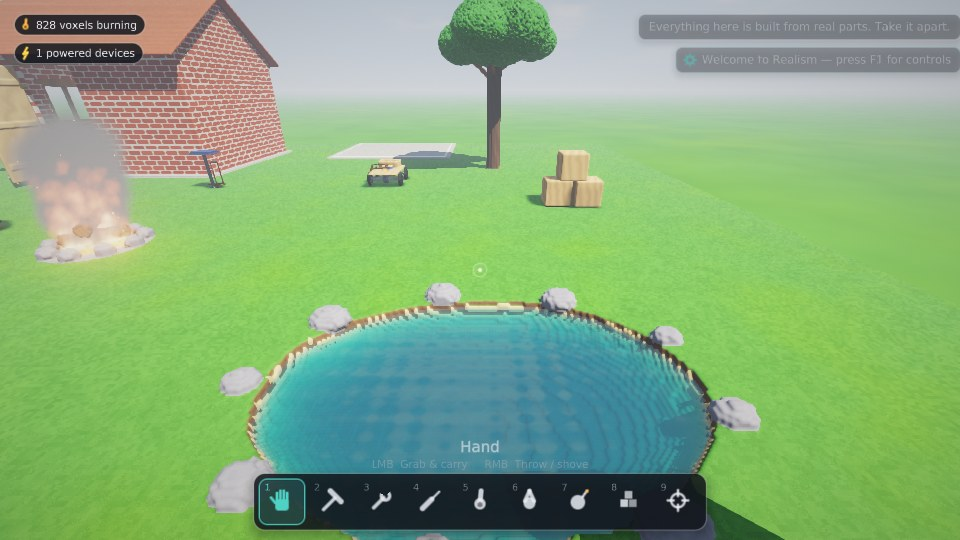

# Realism

A voxel physics sandbox for Windows where every object is assembled from the parts that would make it work, and every part is made of a real material.

The desk lamp is a cast-iron base, a 12 V Li-ion pack with + and − terminals, a toggle switch, copper flex routed up a steel pole, an aluminium shade and a glass bulb with a tungsten filament. The shed is individual bricks laid in mortar under oak rafters and clay tiles. The rover is a plywood deck, a motor on a steel drive shaft, bearing blocks and rubber tyres on steel rims. You can take all of it apart, piece by piece.


| | |
|---|---|
|  |  |
|  |  |

## What's simulated

The world uses **2.5 cm voxels** (64 voxels per litre). It is about 16 m × 16 m × 8 m, roughly 130 million cells stored sparsely, so open air costs nothing. Every voxel carries its material, the part it belongs to, its temperature, damage and burn state.

**Rigid bodies and destruction**
- Loose objects are rigid bodies with real mass and inertia, computed from their voxels.
- They collide with the world and each other through sequential impulses, with friction and restitution taken from the materials.
- An impact's energy goes into the voxels it hits:
  - Part goes into **heat**.
  - Hits above a part's **joint strength** knock the whole part loose: a mortared brick, a nailed plank, a bolted leg.
  - Weaker hits chip a crater.
  - Brittle materials (glass, brick, stone, concrete) **crack** along Voronoi lines into chunks.
- Anything no longer connected to the bedrock breaks off and falls.

**Heat**
- Conduction runs between every pair of touching voxels using real conductivities and heat capacities.
- Exposed faces lose heat by convection and radiation, so hot metal glows and cools.
- Touching bodies exchange heat, and sliding friction warms both surfaces.

**Fire**
- Flammable materials ignite at their real ignition temperatures.
- Fire needs an exposed face for oxygen, burns through its fuel, releases heat, and leaves ash.
- Hot plumes rise and set alight things hanging above, and water puts fires out.

**Phase changes**
- Metals, glass and plastics melt into glowing liquid that flows and freezes back.
- Sand fuses into glass and water boils off.

**Fluids** — water, molten material, sand, ash and gravel flow and slump on the grid. Bodies float or sink by buoyancy.

**Circuits**
- Current flows through copper, battery terminals and closed switches.
- A filament, motor winding, heater coil, detonator or rocket igniter runs when it bridges a source's + and − nets.
- Joining + to − directly is a **short circuit**: the wire heats until it glows, and the battery heats until it goes into thermal runaway.
- Batteries drain, and solar panels only work in sunlight.

**Machines**
- Motors turn steel shafts, and shafts turn wheels (with traction and torque that falls off with speed) and propellers (thrust and airflow that pushes things and fans flames).
- Rockets burn for six seconds and scorch what's behind them.

**Explosives**
- Blast energy falls off with distance and eats exposed material layer by layer, so it digs craters.
- It throws debris and bodies, sets off nearby charges, and lights fires.

Heat runs 20× faster than real time by default (`thermal_warp`), so fires and furnaces play out in seconds. Everything else runs in real time.

## Tools (keys 1–9)

| | Tool | Left mouse | Right mouse |
|---|---|---|---|
| 1 | Hand | Grab and carry (up to ~65 kg; heavier things can only be dragged) | Throw / shove |
| 2 | Hammer | Hold to charge 15–150 J, release to strike | Light tap |
| 3 | Wrench | Unbolt the part you're looking at; it drops free | Salvage it to the workshop |
| 4 | Chisel | Carve a chunk out | Pick out a single voxel |
| 5 | Blowtorch | 12 kW flame | CO₂ cooler (puts fires out) |
| 6 | Hose | Water jet | Wide mist |
| 7 | Charges | Throw a lit stick (3 s fuse) | Stick a remote charge; **G** detonates them all |
| 8 | Builder | Place material (Q material, Z size, X salvaged part) | Remove |
| 9 | Scanner | Full readout: temperature, density, conductivity, ignition and melting points, speed, energy | |

**Other controls**

| Key | Action |
|---|---|
| WASD, Space, Shift, Ctrl | Move, jump, sprint, crouch |
| E | Use: flip switches, reverse motors, light fuses, ignite rockets, check batteries |
| F | Flashlight |
| N | Fly mode |
| T | Slow motion |
| P | Pause |
| V | Smooth or blocky surfaces |
| Tab | Workshop |
| F1 | Help |
| F3 | Performance stats |
| F11 | Fullscreen |
| Esc | Menu and settings |

Looking at anything shows a card with the part, its object, its material, its temperature, how it's fixed (and with how many joules), and what it does.

## The workshop (Tab)

The concrete pad north of the shed holds a build jig, with an orbit camera around it.

- **Placing**: left-click places, right-click erases, right-drag orbits, middle-drag pans, and the wheel zooms.
- **Parts**: drop in batteries, motors, wheels, propellers, switches, bulbs, heaters, solar panels, rockets, charges and crates. Rotate with **R**, tip over with **F**, and mirror left/right with **M**.
- **Materials**: build voxel by voxel from 24 materials, with brush sizes 1–4.
- **Salvage**: parts you salvaged in the world with the wrench appear in the Salvage tab, with their original shape.
- **Live circuits**: wiring works while the build is still clamped in the jig, so bulbs light up and motors spin. Flip switches with **E**.
- **Build analysis**: the right panel shows mass, energy and runtime. It also warns about short circuits, devices not in a closed circuit, motors with nothing to turn, and parts that will fall off.
- **Launch** (Enter) releases the build into the world.
- **Blueprints**: eight working examples to start from (Rover, Fan cart, Rocket sled, Desk lamp, Desk fan, Space heater, Demolition rig, Solar lamp). You can also save your own.

## Smooth voxels

Surfaces are ray-marched on the GPU, so the cost scales with screen pixels rather than voxel count. Each volume also has a linearly filtered density field. Rays refine onto its 0.5 isosurface, and normals come from its gradient, so curves and edges render smooth while the simulation stays voxel-exact. Press **V** to compare with blocky voxels.

## Building

There are no external dependencies: the Win32/WGL platform layer, the OpenGL loader, the UI and the font are all in the source tree.

**Windows (Visual Studio 2022 or Build Tools, CMake 3.20+)**
```
cmake -B build -G "Visual Studio 17 2022" -A x64
cmake --build build --config Release
build\Release\Realism.exe
```
Or open the folder in Visual Studio and pick the Release configuration.

**Cross-compiling from Linux (MinGW-w64)**
```
cmake -B build-win -G Ninja -DCMAKE_TOOLCHAIN_FILE=cmake-mingw.cmake -DCMAKE_BUILD_TYPE=Release
cmake --build build-win
```
This produces a single static `Realism.exe`.

**Linux (X11, for development and testing)**
```
cmake -B build -G Ninja -DCMAKE_BUILD_TYPE=Release && cmake --build build
./build/Realism
```

Requirements: OpenGL 4.3 and a CPU with AVX2.

## Settings and performance

`settings.cfg` sits next to the executable. Changes made in the in-game menu are saved to `%APPDATA%\Realism\settings.cfg`.

| Setting | Default | Notes |
|---|---|---|
| `voxel_size` | 0.025 | Metres per voxel. Every object is defined in metres, so you can go finer. At 0.02 the world uses about 2× the memory and simulation work. |
| `world_x/y/z` | 16 / 8 / 16 | World extent in metres. |
| `render_scale` | 1.0 | Lower it for more frame rate (0.75 is a good laptop setting). |
| `thermal_warp` | 20 | How much faster heat runs than real time. |
| `threads` | 0 | 0 uses every hardware thread. |
| `smooth_surfaces`, `shadows`, `bloom` | on | Also in the in-game menu. |

The defaults target a 6-core/12-thread laptop CPU (e.g. i7-10750H) with an 8 GB GPU:
- About 330 MB of system RAM for the world.
- About 700 MB of VRAM for its 3D textures.
- Heat, contact generation, explosions and circuits run across all threads.

**F3** shows live timings.

## Testing

```
Realism --selftest
```
This builds the world and checks that:
- the lamp's circuit is closed;
- the fan's switch is open;
- the campfire is burning;
- the rover drives when switched on;
- a hammer blow knocks a brick out of the shed wall;
- explosions remove material;
- the torch can bring steel to a glow.

`--script file` runs a command script (`pos`, `wait`, `tool`, `press`, `click`, `explode`, `workshop`, `blueprint`, `launch`, `shot`, `log`), which is used for automated screenshots.

## Licence notes

The UI font is a signed-distance-field atlas generated from DejaVu Sans (Bitstream Vera licence) by `tools/gen_font.py`. See `THIRD_PARTY_NOTICES.md`.
